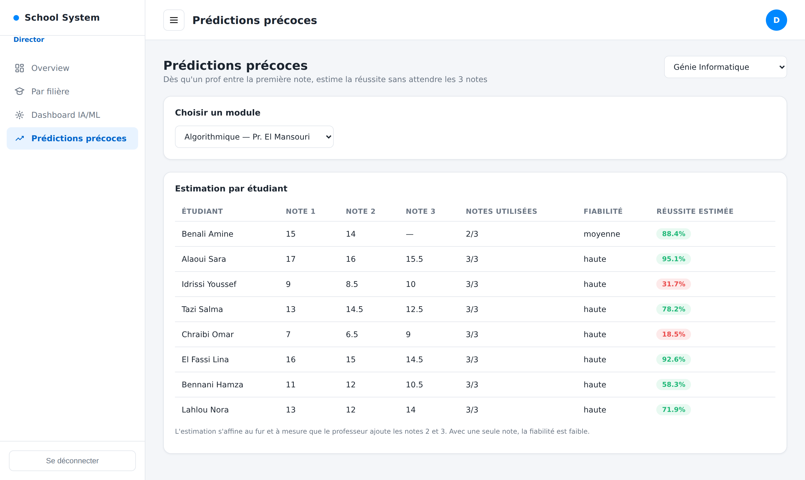
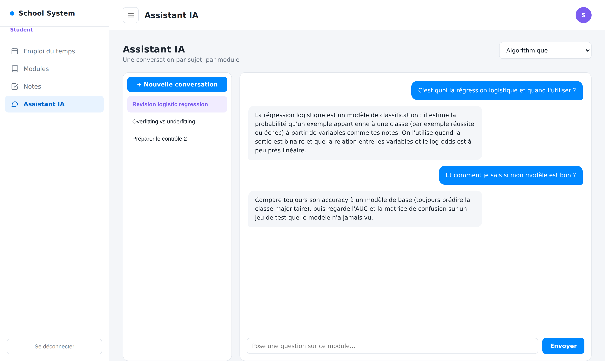

# AI Academic Management System

A role-based school management platform with an AI layer: a **machine-learning model that estimates a student's chance of passing as soon as the first grade is entered**, and a **local LLM study assistant** with one conversation per module.

| Director: early predictions | Student: AI assistant |
|---|---|
|  |  |

> Screenshots use sample data. The training data is synthetic (see *Machine learning* below).

## Architecture

```
web_fronted (HTML/CSS/JS)  ──►  Spring Boot API (JWT, MySQL)  ──►  FastAPI service ──► scikit-learn models
        :5500                          :8080                              :8000       └► Ollama (Llama 3.2)
```

- **backend/**: Spring Boot 3, Spring Security (JWT, stateless), JPA/MySQL. Four roles: Administrator, Director, Professor, Student.
- **Ai_features/**: FastAPI service exposing `/ml/predict-success`, `/ml/predict-progress` and `/ai/ask`.
- **web_fronted/**: one dashboard per role.

## Features

- Administrator: manage filières, professors, students, modules and the weekly timetable.
- Professor: enter grades per module, with ownership checks (a professor only sees their own modules).
- Student: timetable, grades, and an AI assistant with conversation history per module.
- Director: statistics per filière, at-risk students, and early predictions per module.

## Machine learning

Three logistic-regression models (one, two or three grades available), so a prediction exists after the first grade and sharpens as more arrive. The UI shows a confidence level (`faible` / `moyenne` / `haute`).

Training data is **synthetic** (`Ai_features/generate_data.py`, 1,000 students, documented generation rule). Held-out test results (200 students, `metrics.json`):

| Grades used | Accuracy | Baseline (always "pass") | ROC-AUC |
|---|---|---|---|
| 1 | 0.840 | 0.670 | 0.904 |
| 2 | 0.860 | 0.670 | 0.930 |
| 3 | 0.905 | 0.670 | 0.955 |

These numbers show the pipeline works end to end; they are not a claim about real students. Replace `training_data.csv` with real historical grades and run `python train_model.py` to get real metrics.

## Security

- JWT authentication, BCrypt password hashing, stateless sessions.
- **Role-based authorization** on every route group (`/admin`, `/director`, `/professor`, `/student`); default deny.
- Account creation (`/auth/register`) is restricted to administrators.
- Invalid or expired tokens return 401/403, never 500.
- Secrets come from environment variables, not from the repository.
- Tests: `RoleAccessTest` (each role against other roles' endpoints) and `JwtServiceTest`.

## Run it

```bash
# 1. Backend (needs MySQL running, database SchoolManagement)
cd backend
cp ../.env.example ../.env   # edit values, then export them
export DB_PASSWORD=... JWT_SECRET=$(openssl rand -hex 32)
./mvnw spring-boot:run

# 2. AI service
cd Ai_features
pip install -r requirements.txt
python generate_data.py && python train_model.py
ollama pull llama3.2
uvicorn main:app --port 8000

# 3. Frontend: serve web_fronted on port 5500 (e.g. VS Code Live Server)
```

Tests: `cd backend && ./mvnw test` (uses an in-memory H2 database).

## Deploy with Docker (one command)

Requires Docker with the Compose plugin on the server.

```bash
cp .env.example .env      # set DB_PASSWORD, JWT_SECRET, ADMIN_EMAIL, ADMIN_PASSWORD
docker compose up -d --build
```

Then open `http://<server-ip>/` and log in with `ADMIN_EMAIL` / `ADMIN_PASSWORD`.

| Container | Role |
|---|---|
| `frontend` | nginx: serves the pages and proxies `/api` to the backend (only port 80 is public) |
| `backend` | Spring Boot API |
| `db` | MySQL 8.4 (data kept in a volume) |
| `ai` | FastAPI: ML models and LLM gateway |
| `ollama` | runs Llama 3.2; `ollama-pull` downloads it on first start |

The first start downloads the LLM (about 2 GB) and Ollama runs on CPU unless the server has a GPU, so plan for at least 4 GB of RAM. Use HTTPS in production (for example Caddy or nginx with Let's Encrypt in front of port 80).

## Deploy on a free single-container host (no shell needed)

The root `Dockerfile` builds ONE image containing MariaDB, the backend, the AI service and nginx. The database, its user and the tables are created automatically on first start.

Set these environment variables in the host's dashboard (all optional except where noted):

| Variable | Purpose |
|---|---|
| `JWT_SECRET` | token signing key. If missing, a temporary one is generated (users are logged out on every restart) |
| `ADMIN_EMAIL`, `ADMIN_PASSWORD` | first administrator, created if it does not exist. **Set these, or you cannot log in** |
| `OLLAMA_BASE` | URL of an external Ollama server for the AI chat. Without it the chat answers "Ollama not reachable"; the grade predictions still work |
| `DB_PASSWORD` | optional, the database is only reachable inside the container |

Notes: free hosts usually wipe the container's disk on restart, so the data is lost unless you attach a volume at `/var/lib/mysql`. The image needs about 1 GB of RAM. Llama 3.2 cannot run on free tiers.
